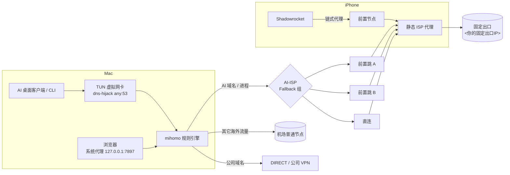

# ai-network-setup-skill

一套给日常用 AI 工具的开发者准备的网络配置方法：从「电脑能稳定用」开始，一层层加到手机一致、和公司 VPN 共存、自动巡检。它既是一份人能照着做的 SOP，也是一个可以直接交给 AI 代理执行的 Agent Skill。

目前在 macOS + iPhone 上实测过。其它平台见 [docs/ROADMAP.md](docs/ROADMAP.md)。

> **先说边界**：这套东西解决的是出口稳定、和公司网络兼容、不泄漏。它**不用于**规避服务的地区限制、封禁或 KYC，也不涉及伪造身份。请遵守当地法律、公司安全策略和各服务的条款，用真实身份和真实支付方式注册服务。

---

## 1. 它解决什么问题

用 AI 工具（桌面客户端、浏览器、CLI）写代码时，网络问题通常是这几种：

- **出口跳来跳去。** 机场节点一换，你的出口 IP 和地区就变了，同一个会话前后像是从不同地方连的。
- **以为全走了代理，其实没有。** DNS 走了本地运营商，或者浏览器的 WebRTC 直接把真实 IP 暴露给网页。
- **公司 VPN 和代理打架。** 连上 VPN 后很慢，内网域名解析失败，公司的 CLI 工具报证书错误。
- **长连接莫名断开。** 客户端提示 "Connection went idle"，不知道是哪一段出了问题。
- **不知道到底配好没有。** 配完只能凭感觉，没有一条命令能告诉你"现在是对的"。

这个仓库把每个问题拆到对应的层里，每层都写了怎么配、怎么验证、出问题怎么回滚。

## 2. 名词白话

| 名词 | 一句话解释 |
|---|---|
| Clash Verge Rev / mihomo | Clash Verge Rev 是 macOS 上的图形客户端，真正干活的内核叫 mihomo，负责按规则把流量分到不同出口。 |
| 订阅 | 服务商给你的一个链接，客户端从里面拉节点列表。只在客户端界面里粘贴，不要写进任何文件。 |
| 脚本覆写（Script override） | 在订阅基础上追加你自己的节点、代理组和规则。订阅更新时你的改动不会被冲掉。 |
| 代理组 / Fallback | 把几个节点编成一组。Fallback 组按顺序用第一个健康的，坏了自动换下一个。 |
| TUN | 客户端虚拟一张网卡，把整台机器的流量都接管过来，包括不认系统代理的程序。 |
| fake-ip | DNS 查询先返回一个假地址（198.18.x.x），真正的解析交给代理去做，本地不会把域名查询泄漏给运营商。 |
| 系统代理与 bypass | 系统代理是给浏览器等程序用的 `127.0.0.1:7897`；bypass 是"这些地址不走代理"的名单，公司域名要放进去。 |
| 静态 ISP 代理 vs 机场 | 机场：节点多、便宜，但出口是共享的机房 IP，会变。静态 ISP 代理：一个固定 IP，归属家宽/运营商，按 IP 或流量收费。 |
| 前置跳 / 链式代理 | 先连 A（前置跳），再从 A 连到 B（最终出口）。用来改善从国内直连静态代理不稳的问题。 |
| WebRTC 泄漏 | 浏览器做音视频通话用的 WebRTC 可能绕过代理，让网页拿到你的真实 IP。 |
| split DNS | 不同域名交给不同 DNS 解析，比如公司域名走公司 DNS，其它走公共 DNS。macOS 上用 `/etc/resolver/<域名>` 实现。 |
| Shadowrocket | iOS 上的代理客户端，支持规则、代理组和链式代理，这里用它让手机和电脑走同一套出口逻辑。 |
| launchd | macOS 自带的后台任务管理，可以按时间跑脚本，本仓库用它定时巡检。 |

## 3. 设计思路

核心就一句话：**AI 工具的流量只走一个固定出口；通往这个出口的路有好几条，坏了一条自动换。**

具体做法：

1. **同一固定出口 + 多个前置跳。** 一个静态 ISP 代理，配成 3–4 个节点：分别经前置节点 A、B 过去，再加一个直连。这几个节点放进一个 Fallback 组（模板里叫 `AI-ISP`）。哪条路坏了换哪条，出口 IP 不变。
2. **规则置顶。** AI 相关的进程名和域名规则插在规则列表最前面，订阅自带的规则不会抢先命中。
3. **公司域名直连。** 公司域名在 Clash 规则里走 DIRECT，系统代理 bypass 里也加上，VPN 和内网工具不受影响。
4. **防泄漏。** TUN 接管全部流量，fake-ip 管住 DNS，浏览器装 WebRTC 限制插件，系统 IPv6 关掉。
5. **只读巡检。** `scripts/net-check.sh` 只读不改，定时跑，出口不对就报警，修不修由人决定。



## 4. 分层一览

| 层 | 解决什么 | 适合谁 | 大概耗时* | 对应文件 |
|---|---|---|---|---|
| L0 总览与红线 | 先知道哪些事不能做 | 所有人，必读 | 5 分钟 | [00-overview.md](skills/ai-network-setup/references/00-overview.md) |
| L1 Clash 基础 | 电脑固定出口、TUN、fake-ip、公司域名直连 | 所有人 | 30–60 分钟 | [01-basic-clash.md](skills/ai-network-setup/references/01-basic-clash.md)、[clash 脚本模板](templates/clash-verge-script-override.example.js) |
| L2.1 浏览器插件 | WebRTC 泄漏 | 用浏览器访问 AI 服务的人 | 5 分钟 | [02-tools-browser-shadowrocket.md](skills/ai-network-setup/references/02-tools-browser-shadowrocket.md) |
| L2.2 Shadowrocket | 手机和电脑出口一致 | 手机也用 AI 工具的人 | 15–30 分钟 | 同上、[shadowrocket.conf](templates/shadowrocket.conf) |
| L3 进阶 | 公司 VPN 共存、split DNS、Tailscale、IPv6 | 在公司网络或用 VPN 的人 | 30 分钟起 | [03-advanced.md](skills/ai-network-setup/references/03-advanced.md) |
| L4 服务选购 | 机场、静态 ISP、VPS 怎么选 | 还没买服务、或想换的人 | 看个人 | [04-service-selection.md](skills/ai-network-setup/references/04-service-selection.md) |
| L5 定时巡检 | 自动发现出口跳变、节点变慢 | 想省心的人 | 10 分钟 | [05-scheduled-checks.md](skills/ai-network-setup/references/05-scheduled-checks.md)、[net-check.sh](scripts/net-check.sh)、[plist 模板](templates/com.example.net-check.plist) |
| 排障 | 现象 → 原因 → 处理；新设备 / 同事 checklist | 出问题的时候 | — | [troubleshooting.md](skills/ai-network-setup/references/troubleshooting.md) |

\* 耗时是经验估计，熟练程度不同差别很大。

## 5. 你的诉求 → 看哪层

| 你想要 / 你遇到 | 看这里 |
|---|---|
| 电脑上 AI 工具能稳定用就行 | L1 |
| 出口 IP 老是变 | L1（AI-ISP Fallback 组），再用 L5 盯着 |
| 测试网站显示了我的真实 IP | L2.1 WebRTC 插件；再查 L1 的 TUN 和 fake-ip |
| 手机上也要和电脑一样 | L2.2 |
| 连上公司 VPN 后特别慢 | L3.1 |
| 公司内网域名解析失败、SERVFAIL | L3.2 split DNS |
| 公司 CLI 工具报证书错误 | L1 第 8 步 bypass + L3.7 |
| 装了 Tailscale，担心它改 DNS 或出口 | L3.3 |
| 测试站显示 IPv6，不知道是不是泄漏 | L3.5 |
| 改了脚本没生效 | L1 第 5 步（要重新激活订阅）、troubleshooting |
| 不知道该买什么服务 | L4 |
| 想自动检查、出问题提醒 | L5 |
| 客户端提示 "Connection went idle" | troubleshooting |
| 给新电脑或同事复刻一套 | troubleshooting 里的新设备 / 同事 checklist |

## 6. 三种用法

### ① 自己照着做（推荐路径）

1. 读 [L0](skills/ai-network-setup/references/00-overview.md)，记住红线：AI 客户端开着的时候不要重载 Clash；改配置前先备份；不碰公司的安全组件；不把凭据贴到任何地方。
2. 准备好你自己的机场订阅和静态 ISP 代理账号。还没买的先看 L4。
3. 按 L1 配 Clash Verge Rev，脚本覆写从 `templates/clash-verge-script-override.example.js` 改起。
4. 跑 L1 的验证命令，确认出口是你预期的那个 IP。
5. 跑一次 `scripts/net-check.sh`，全部 `[OK]` 再往下。
6. 按需做 L2（浏览器、手机）和 L3（公司网络）。
7. 最后用 L5 配定时巡检。

每层都按「目标 / 前置条件 / 步骤 / 验证 / 常见坑 / 回滚」写，卡住了先看那层的「常见坑」。

### ② 让 AI 代理帮你做（Codex / Claude Code / Cursor 等）

把仓库 clone 到本地，在仓库目录里打开你的 AI 代理，复制下面的提示词。三条都要求先只读、改动前问你。

**新机配置：**
```
阅读 skills/ai-network-setup/SKILL.md 和 references/ 下的分层文档。这是一台新 Mac，
请按 L0→L1 的顺序带我配置。每一步先告诉我要做什么、为什么，等我确认再执行。
凭据和订阅链接由我自己在客户端界面里填，你不要读取或打印。不要重载或退出 Clash。
```

**体检：**
```
阅读 skills/ai-network-setup/SKILL.md。只读检查这台 Mac 的网络配置：
运行 EXPECTED_IP=<你的固定出口IP> ./scripts/net-check.sh，再对照 L1–L3 列出不一致的地方，
按严重程度排序给出建议。不要改任何配置，不要打印凭据。
```

**排障：**
```
我遇到的问题是：<描述现象，比如连公司 VPN 后很慢 / 出口 IP 变了>。
阅读 skills/ai-network-setup/references/troubleshooting.md 和相关层级文档，
先用只读命令定位原因，告诉我结论和修复方案，等我同意后再动手。不要重载 Clash。
```

### ③ 作为 Agent Skill 安装

`skills/ai-network-setup/` 是标准 Agent Skill 目录：根部有带 `name` / `description` frontmatter 的 `SKILL.md`，详细内容在 `references/`。

- **Claude Code**：放到 `~/.claude/skills/ai-network-setup/`（全局）或项目里的 `.claude/skills/ai-network-setup/`。
- **Codex、Cursor 及其它支持 Agent Skills 的工具**：skills 目录位置以各工具文档为准。

注意：`SKILL.md` 用相对路径 `../../scripts/`、`../../templates/` 引用脚本和模板。只复制 `skills/ai-network-setup/` 的话，记得把 `scripts/` 和 `templates/` 一起带上，或者改一下 SKILL.md 里的路径。最省事的做法是把整个仓库放在固定位置，再把 skills 目录软链过去：

```bash
ln -s "$PWD/skills/ai-network-setup" ~/.claude/skills/ai-network-setup
```

装好后跟代理说"按网络 SOP 帮我检查一下这台电脑"就会用上。

## 7. 10 分钟快速上手

前提：已经装好 Clash Verge Rev、导入了订阅，静态 ISP 代理账号在手。

```bash
git clone https://github.com/Jzzwww/ai-network-setup-skill.git
cd ai-network-setup-skill
```

1. 打开 `templates/clash-verge-script-override.example.js`，在 Clash Verge 里把它粘到订阅的「扩展脚本」中，替换占位符（凭据只在这里填）。
2. 先关掉 AI 客户端，然后在 Clash Verge 里重新激活订阅。
3. 打开 TUN（gVisor）和系统代理（端口 7897）。
4. 验证：

```bash
# 经系统代理和经 TUN 各看一次，ip 应该都是你的固定出口
curl -s -x http://127.0.0.1:7897 https://claude.ai/cdn-cgi/trace | grep -E '^(ip|loc|colo)='
curl -s --noproxy '*'           https://claude.ai/cdn-cgi/trace | grep -E '^(ip|loc|colo)='

# 完整体检
EXPECTED_IP=<你的固定出口IP> ./scripts/net-check.sh
```

`net-check.sh` 输出长这样（**示例**，IP 和节点名是虚构的）：

```
== net-check 2026-01-01 10:36:00 CST ==
[OK]   trace(proxy) ip=203.0.113.10 colo=EWR loc=US
[OK]   trace(tun) ip=203.0.113.10 colo=EWR loc=US
[OK]   普通出口 198.51.100.20
[INFO] Claude-ISP Fallback now= ISP-via1 all= ['ISP-via1', 'ISP-via2', 'ISP-direct']
[OK]   Claude-ISP 为 Fallback
[OK]   延迟 ISP-via1 224ms
[OK]   延迟 ISP-via2 266ms
[OK]   延迟 ISP-direct 434ms
[OK]   fake-ip 198.18.0.59
[OK]   无全局 IPv6 地址
[OK]   系统代理 127.0.0.1:7897
[OK]   dns-guard 在运行
== 结果: FAIL=0 WARN=0 ==
```

退出码：`0` 全部正常，`1` 有 WARN，`2` 有 FAIL。可选环境变量：`EXPECTED_COLO`、`CLASH_SOCK`、`PROXY_PORT`（默认 7897）、`GROUP`（默认 `Claude-ISP`，用模板的话设成 `GROUP=AI-ISP`）、`BYPASS_DOMAINS`（空格分隔，检查系统代理 bypass 里有没有这些域名）。脚本只读，不改任何配置。

## 8. 参考信息

### 需要替换的占位符

| 占位符 | 含义 |
|---|---|
| `<你的订阅URL>` | 机场订阅链接，只在客户端界面粘贴 |
| `<ISP代理host>` `<端口>` `<用户名>` `<密码>` | 静态 ISP 代理信息，只在本地填 |
| `<前置节点A名称>` `<前置节点B名称>` | 订阅里已有的节点名，用作前置跳 |
| `<你的固定出口IP>` | 静态 ISP 代理的出口 IP，用于验证 |
| `<机房如EWR>` | trace 里的 `colo` 值，可选 |
| `<公司域名1>` `<公司域名2>` / `<公司域名>` | 需要直连的公司域名 |
| `<公司内网DNS>` | 公司内网 DNS 地址 |
| `<VPN网关域名>` | 公司 VPN 网关 |
| `<你的用户名>` | macOS 用户名（plist 里的路径） |
| `<uid>` | `id -u` 的输出，用于 Clash socket 路径 |

### 仓库结构

```
.
├── README.md
├── LICENSE                         MIT
├── CONTRIBUTING.md
├── docs/ROADMAP.md                 待补内容
├── scripts/net-check.sh            只读巡检脚本（macOS）
├── templates/
│   ├── clash-verge-script-override.example.js   Clash 脚本覆写示例
│   ├── shadowrocket.conf                         Shadowrocket 配置模板
│   └── com.example.net-check.plist               launchd 定时巡检模板
└── skills/ai-network-setup/
    ├── SKILL.md                    Agent Skill 入口
    └── references/                 00–05 分层文档 + troubleshooting.md
```

### 安全与合规

- 本仓库**不用于**规避服务的地区限制、封禁或 KYC，不提供伪造身份相关内容。请遵守当地法律法规、公司安全策略和各服务条款，使用真实身份和支付方式。
- 不禁用、不绕过公司的安全组件（DNS 安全扩展、VPN、设备管理）。
- 所有凭据、订阅链接都只在客户端里填。不要写进仓库文件，不要发到 Issue / PR / 群聊。
- 巡检脚本只读。改配置前先备份，改完确认运行时配置和磁盘上的一致。

### 平台支持现状

| 平台 | 状态 |
|---|---|
| macOS + Clash Verge Rev | 已实测 |
| iOS + Shadowrocket | 已实测 |
| Windows、Linux、Android、Surge / Stash / sing-box、路由器 | 未覆盖，见 [ROADMAP](docs/ROADMAP.md) |

### FAQ

**为什么要静态 ISP 代理，机场不够吗？**
机场出口是共享的，还会变。只想稳定用的话，机场 + L1 的规则也能用；需要出口始终是同一个 IP，才需要静态 ISP 代理。

**为什么要前置跳，直连静态代理不行吗？**
可以，模板里本来就有一个 direct 节点。前置跳是为了让直连质量差的时候还有别的路可走。

**AI 客户端开着能改配置吗？**
尽量别。重新激活订阅就是重载，会断开现有连接，期间出口可能变。先关客户端再改。

**系统 DNS 显示 114.114.114.114，是不是出问题了？**
不是。这是开 TUN 后 Clash Verge 写进去的占位值，实际 DNS 由 Clash 接管。

**测试网站显示了一个 IPv6 地址，是泄漏吗？**
先确认系统 IPv6 已关（L3.5）。如果显示的是代理节点的 IPv6，就不是泄漏。

**只改了 `verge.yaml` 里的 bypass，为什么不生效？**
这个字段要通过 Clash Verge 的界面改才会生效，见 L3.7。

**net-check.sh 会改我的配置吗？**
不会。它只发 curl 请求、对 Clash 本地 socket 做 GET、读系统设置。

**能在 Windows 上用吗？**
思路通用，但文档和脚本目前只针对 macOS，欢迎补充。

### 贡献

欢迎 PR，尤其是 ROADMAP 里的其它平台和英文翻译。提交前请看 [CONTRIBUTING.md](CONTRIBUTING.md)：不提交真实凭据或内部域名，脚本通过 `shellcheck -S warning`，价格之类的数据要附来源。

### License

[MIT](LICENSE)

---

## English

**What it is.** A layered, basic-to-advanced SOP and Agent Skill for developers who use AI tools and want a **stable, consistent proxy egress with leak prevention** on macOS and iPhone. It covers Clash Verge Rev with a fixed-egress Fallback group (one static ISP proxy reached through several upstream hops), TUN + fake-IP DNS, the WebRTC Network Limiter extension, Shadowrocket, coexistence with corporate VPN and split DNS, how to pick a provider, and a read-only health-check script you can schedule with launchd.

**How to use it.** Follow the layer docs in `skills/ai-network-setup/references/` yourself, ask an AI coding agent to work through `SKILL.md` (read-only first), or install `skills/ai-network-setup/` as an Agent Skill.

**Scope.** It is **not** meant for getting around service region restrictions, bans, or KYC. Follow local laws, your employer's security policies, and each service's Terms of Service. Never commit credentials. Docs are Chinese-only for now; macOS and iOS are tested, other platforms are on the [roadmap](docs/ROADMAP.md).
