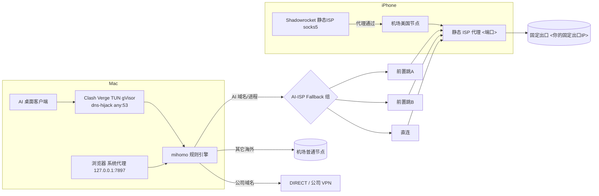

## 0. 总览与红线

### 红线（任何时候）
1. **出口固定**：AI 工具（如 Claude）流量只走一个固定出口 `<你的固定出口IP>`。不随手切到其它出口。
2. **AI 客户端运行时不热重载、不退出 Clash**（会断流，导致出口跳变）。改配置挑客户端关闭的时间。
3. **不动公司安全组件**：不禁用/绕过 公司 DNS 安全组件、公司 VPN 客户端、MDM、浏览器托管策略。
4. **改前先备份**：`cp FILE FILE.bak-<用途>-$(date +%Y%m%d%H%M%S)`。
5. **运行时 == 磁盘**：改完回读运行时配置（Clash API）与磁盘文件一致。
6. **永不打印密钥**：订阅 profile 文件含节点凭据，不 `cat`、不截图、不贴聊天。
7. 巡检默认只读。

### 拓扑

核心思想：**同一个静态出口，经多个不同前置跳**组成 Fallback；任一前置坏了自动换，但出口 IP 不变。

---
